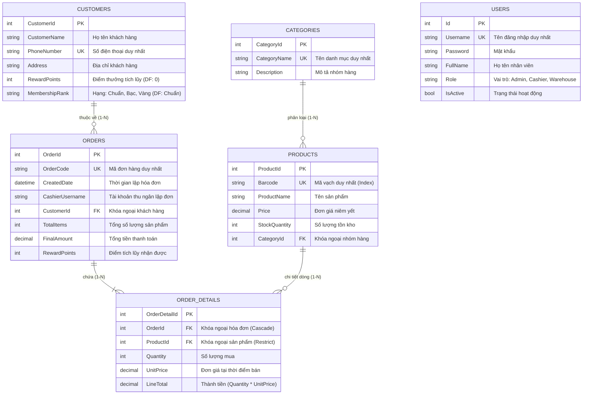

# 🛒 HỆ THỐNG QUẢN LÝ SIÊU THỊ MINI (MINISUPERMARKET MANAGEMENT SYSTEM)
### Đề tài: Phát triển Ứng dụng Thu ngân và Quản lý Hàng hóa cho Mô hình Bán lẻ – Cửa hàng Tiện lợi Alpha Mini

## 1. Giới thiệu Tổng quan Đề tài

Trong ngành bán lẻ hiện đại, mô hình chuỗi siêu thị mini và cửa hàng tiện lợi (**Convenience Store - Alpha Mini**) đòi hỏi hệ thống phần mềm phải giải quyết trọn vẹn hai bài toán lớn:
1. **Tốc độ và tính sẵn sàng cao tại quầy thu ngân (Front-end POS):** Quá trình quét mã vạch sản phẩm, thêm vào giỏ hàng, áp dụng tích điểm và in bill phải diễn ra trong vài phần nghìn giây. Nhân viên thu ngân thao tác nhanh, không bị đơ giật giao diện ngay cả khi siêu thị đông khách vào giờ cao điểm.
2. **Tính toàn vẹn dữ liệu và an toàn nghiệp vụ (Back-end Core):** Mỗi giao dịch thanh toán tác động đồng thời đến doanh thu, điểm tích lũy của khách hàng và biến động tồn kho thực tế. Dữ liệu kho không được phép sai lệch hay xảy ra hiện tượng bán âm; tài khoản và dữ liệu hệ thống phải được bảo mật tuyệt đối.

Đồ án **"Phát triển Ứng dụng Thu ngân và Quản lý Hàng hóa cho Mô hình Bán lẻ – Cửa hàng Tiện lợi Alpha Mini"** của sinh viên **Mai Chí Cường** được nghiên cứu và xây dựng toàn diện trên nền tảng **C# .NET 8**, áp dụng mô hình phân tầng Client - Server kết hợp kiến trúc truy xuất dữ liệu lai (**Hybrid Data Access**) giữa **Entity Framework Core 8** và **ADO.NET thuần**.

---

## 2. Mô hình Kiến trúc Hệ thống

Hệ thống được tổ chức theo kiến trúc phân tầng độc lập (**Multi-Tier Client - Server Architecture**), đảm bảo khả năng mở rộng (Scalability), bảo trì dễ dàng và tối ưu hiệu năng:

```
  ┌────────────────────────────────────────────────────────────────────────┐
  │              MÁY TRẠM BÁN HÀNG & QUẢN LÝ (DESKTOP CLIENT)              │
  │              MiniSupermarket.WinForms (C# Windows Forms .NET 8)        │
  │  ┌───────────────────────┬──────────────────────┬───────────────────┐  │
  │  │ FormLogin (Xác thực)  │ FormMainShell (Menu) │ FormPOS (Bán hàng)│  │
  │  ├───────────────────────┼──────────────────────┼───────────────────┤  │
  │  │ FormProductManagement │ FormCategoryManage   │ FormCustomerManage│  │
  │  ├───────────────────────┴──────────────────────┴───────────────────┤  │
  │  │ FormUserManagement    │ FormQuickReport (Thống kê & Charting)    │  │
  │  └──────────────────────────────────────────────────────────────────┘  │
  │      ▲ SessionManager (Lưu Token, Role, Tên NV)                        │
  │      ▼ ApiClientService (HttpClient Singleton, Auto Bearer Header)    │
  └───────────────────────────────────┬────────────────────────────────────┘
                                      │ HTTP / HTTPS (RESTful JSON)
                                      │ Port: https://localhost:7132/api/
                                      │ Header: Authorization: Bearer <Token>
                                      ▼
  ┌────────────────────────────────────────────────────────────────────────┐
  │                 MÁY CHỦ DỊCH VỤ TRUNG TÂM (BACKEND SERVER)             │
  │             MiniSupermarket.API (ASP.NET Core 8 Web API)               │
  │  ┌──────────────────────────────────────────────────────────────────┐  │
  │  │ API Controllers:                                                 │  │
  │  │ • AuthController        • ProductsController  • CategoriesCtrl   │  │
  │  │ • CheckoutController    • AdoProductController• CustomersCtrl    │  │
  │  │ • OrdersController      • ReportsController   • UsersController  │  │
  │  ├──────────────────────────────────┬───────────────────────────────┤  │
  │  │     ENTITY FRAMEWORK CORE 8      │     ADO.NET NATIVE DRIVER     │  │
  │  │  (Data Access Layer - Quản trị)  │  (High Performance Data Layer)│  │
  │  │  • SupermarketDbContext          │  • Microsoft.Data.SqlClient   │  │
  │  │  • LINQ to Entities              │  • SqlConnection, SqlCommand  │  │
  │  │  • Data Seeding & Migrations     │  • SqlDataReader (Fast Read)  │  │
  │  │  • AsNoTracking() Optimization   │  • DataTable, SqlDataAdapter  │  │
  │  │  • Cascade / Restrict Rules      │  • SqlTransaction (ACID)      │  │
  │  └──────────────────┬───────────────┴───────────────┬───────────────┘  │
  └─────────────────────┼───────────────────────────────┼──────────────────┘
                        │                               │
                        ▼                               ▼
  ┌────────────────────────────────────────────────────────────────────────┐
  │            HỆ QUẢN TRỊ CƠ SỞ DỮ LIỆU MICROSOFT SQL SERVER              │
  │                 Database: ChiCuong_MiniSupermarketDb                   │
  │  ┌───────────────────┬───────────────────┬──────────────────────────┐  │
  │  │ Users (15 records)│ Categories (15 gr)│ Products (45 hàng hóa)   │  │
  │  ├───────────────────┼───────────────────┼──────────────────────────┤  │
  │  │ Customers (20+1)  │ Orders (Hóa đơn)  │ OrderDetails (Chi tiết)  │  │
  │  └───────────────────┴───────────────────┴──────────────────────────┘  │
  │  Stored Procedures: sp_GetRevenueByCashier, sp_GetRevenueByDateRange   │
  └────────────────────────────────────────────────────────────────────────┘
```

---

## 3. Cấu trúc Solution & Toàn bộ Mã nguồn Thực tế

Toàn bộ đồ án được lưu trữ tại `D:\MiniSupermarket_MaiChiCuong`, bao gồm 2 dự án thành phần liên kết chặt chẽ:

```text
D:\MiniSupermarket_MaiChiCuong/
│
├── MiniSupermarket_MaiChiCuong.sln          # Solution file chính của đồ án
├── README.md                                # Tài liệu kỹ thuật tổng hợp toàn diện
├── reame.md                                 # Bản sao đồng bộ tài liệu
│
├── MiniSupermarket.API/                     # BACKEND: Dịch vụ ASP.NET Core 8 Web API
│   ├── Controllers/                         # Tầng điều khiển tiếp nhận yêu cầu mạng
│   │   ├── AuthController.cs                # Xác thực tài khoản, kiểm tra mật khẩu, sinh JWT Token
│   │   ├── ProductsController.cs            # Quản lý hàng hóa, phân trang, lọc, xuất ClosedXML (.xlsx)/CSV
│   │   ├── CategoriesController.cs          # Quản lý nhóm ngành hàng, kiểm tra trùng tên danh mục
│   │   ├── CustomersController.cs           # Quản lý khách hàng thân thiết, tra cứu theo SĐT, phân trang
│   │   ├── OrdersController.cs              # Quản lý hóa đơn bán hàng, xem chi tiết từng đơn
│   │   ├── CheckoutController.cs            # Thanh toán POS nguyên tử bảo vệ bởi SqlTransaction (ACID)
│   │   ├── AdoProductController.cs          # ADO.NET thuần: Tra cứu mã vạch siêu tốc & Cache RAM ngắt kết nối
│   │   ├── ReportsController.cs             # Dashboard 4 thẻ KPI, Top 5 bán chạy, gọi Stored Procedure
│   │   ├── UsersController.cs               # Quản lý danh sách nhân viên, cấp vai trò Admin/Cashier
│   │   └── RolesController.cs               # Danh mục các vai trò hợp lệ trong hệ thống
│   │
│   ├── Data/
│   │   └── SupermarketDbContext.cs          # Cấu hình Fluent API, quan hệ bảng, Unique Index và Seed Data
│   │
│   ├── DTOs/                                # Đối tượng truyền tải dữ liệu (Data Transfer Objects)
│   │   ├── CheckoutDtos.cs                  # DTO thanh toán giỏ hàng, thông tin thu ngân, khách hàng
│   │   ├── PagedResponseDto.cs              # DTO đóng gói kết quả phân trang chuẩn hóa
│   │   ├── CashierRevenueDto.cs             # DTO nhận dữ liệu từ Stored Procedure doanh thu thu ngân
│   │   └── Role.cs                          # DTO cấu trúc vai trò người dùng
│   │
│   ├── Models/                              # Các thực thể dữ liệu ánh xạ bảng SQL Server
│   │   ├── User.cs                          # Thực thể tài khoản nhân viên
│   │   ├── Category.cs                      # Thực thể nhóm danh mục hàng hóa
│   │   ├── Product.cs                       # Thực thể hàng hóa, mã vạch, giá niêm yết, tồn kho
│   │   ├── Customer.cs                      # Thực thể khách hàng thân thiết, điểm tích lũy
│   │   ├── Order.cs                         # Thực thể hóa đơn bán lẻ
│   │   └── OrderDetail.cs                   # Thực thể dòng chi tiết hóa đơn
│   │
│   ├── Migrations/                          # Các bản di trú lược đồ CSDL tự động của EF Core
│   ├── appsettings.json                     # Cấu hình kết nối SQL Server và Secret Key JWT
│   └── Program.cs                           # Cấu hình DI, Middleware, Swagger OpenAPI, JWT Bearer
│
└── MiniSupermarket.WinForms/                # FRONTEND: Ứng dụng Desktop Windows Forms (.NET 8)
    ├── FormLogin.cs                         # Màn hình đăng nhập xác thực tài khoản & nhận JWT Token
    ├── FormMainShell.cs                     # Khung giao diện chính (Shell), Sidebar điều hướng không giật lag
    ├── FormPOS.cs                           # Giao diện bán hàng POS tại quầy (quét mã vạch, giỏ hàng, tính tiền)
    ├── FormProductManagement.cs             # Màn hình quản lý hàng hóa, phân trang, tô màu cảnh báo tồn kho
    ├── FormCategoryManagement.cs            # Màn hình quản lý nhóm ngành hàng với phân trang
    ├── FormCustomerManagement.cs            # Màn hình quản lý thông tin khách hàng, kiểm tra regex SĐT
    ├── FormUserManagement.cs                # Màn hình quản trị nhân viên và phân quyền hệ thống
    ├── FormQuickReport.cs                   # Màn hình báo cáo doanh thu, 4 thẻ KPI, vẽ biểu đồ Charting
    ├── SessionManager.cs                    # Quản lý phiên làm việc tĩnh & ApiClientService tự gắn Token
    └── Program.cs                           # Điểm khởi chạy ứng dụng (Entry Point)
```

---

## 4. Thiết kế Cơ sở Dữ liệu & Ràng buộc Thực thể

### 4.1 Sơ đồ Quan hệ Thực thể (ERD Diagram)



### 4.2 Chi tiết 6 Bảng Nghiệp vụ và Seed Data Chuẩn

Trong file [`SupermarketDbContext.cs`](file:///d:/MiniSupermarket_MaiChiCuong/MiniSupermarket.API/Data/SupermarketDbContext.cs), cơ sở dữ liệu đã được cấu hình chặt chẽ với Fluent API và nạp sẵn dữ liệu thực tế mẫu:
1. **Bảng `Users` (15 tài khoản):**
   - Quản trị viên: `admin01`, `admin02`, `supervisor`, `admin_backup` (Role: `Admin`).
   - Thu ngân: `cashier01` đến `cashier06` (Role: `Cashier`).
   - Thủ kho: `ware01` đến `ware05` (Role: `Warehouse`).
2. **Bảng `Categories` (15 nhóm ngành hàng):**
   - Bao quát toàn bộ ngành hàng tiện lợi: Nước giải khát (ID 1), Sữa & sản phẩm từ sữa (ID 2), Bánh kẹo & snack (ID 3), Mì ăn liền & cháo gói (ID 4), Kem & thực phẩm đông lạnh (ID 7), Cà phê & trà (ID 8), Gia vị & thực phẩm khô (ID 9), Đồ hộp (ID 10), Trái cây & rau củ tiện lợi (ID 11), Chăm sóc cá nhân (ID 12), Đồ gia dụng & vệ sinh (ID 13), Văn phòng phẩm (ID 14), Phụ kiện tiện ích (ID 15).
3. **Bảng `Products` (45 mặt hàng tiện lợi tiêu biểu):**
   - Mỗi nhóm ngành hàng có 3 sản phẩm mẫu với mã vạch chuẩn EAN-13 duy nhất (`8930000000011` đến `8930000000455`).
   - Giá cả và số lượng tồn kho được thiết lập sát với thực tế chuỗi cửa hàng bán lẻ.
4. **Bảng `Customers` (20 hội viên + 1 khách lẻ):**
   - 20 khách hàng thân thiết có số điện thoại từ `0901000001` đến `0901000020`, đầy đủ điểm tích lũy và thứ hạng hội viên (Chuẩn, Bạc, Vàng).
   - Địa chỉ được cập nhật chuẩn theo đơn vị hành chính mới tại TP. Hồ Chí Minh.
   - **Đặc biệt: Khách hàng ID 21 mang tên "Khách lẻ"** đóng vai trò là khách vãng lai mặc định khi khách không muốn cung cấp số điện thoại tích điểm.
5. **Bảng `Orders` & `OrderDetails`:**
   - Dữ liệu hóa đơn bán lẻ thực tế gắn liền với nhân viên thu ngân ca trực và khách hàng, làm nền tảng trực tiếp cho các báo cáo doanh thu chính xác, không dùng số liệu ngẫu nhiên.

## 5. Chi tiết Các Phân hệ Chức năng và Mã nguồn Hiện thực

### 5.1 Phân hệ Xác thực Bảo mật & Phân quyền
- **Màn hình Đăng nhập ([`FormLogin.cs`](file:///d:/MiniSupermarket_MaiChiCuong/MiniSupermarket.WinForms/FormLogin.cs)):**
  - Giao diện thân thiện, nút `AcceptButton = btnLogin` cho phép nhấn Enter để đăng nhập nhanh; mật khẩu được che bằng `UseSystemPasswordChar`.
  - Gọi bất đồng bộ đến endpoint `POST /api/auth/login`. Khi đăng nhập thành công, token được lưu vào `SessionManager.JwtToken` và mở màn hình chính `FormMainShell`.
- **Khung Điều hướng Không Giật Lag ([`FormMainShell.cs`](file:///d:/MiniSupermarket_MaiChiCuong/MiniSupermarket.WinForms/FormMainShell.cs)):**
  - Áp dụng phương pháp nhúng Form con động (**Child Form Docking**) vào vùng `panelMainContent`.
  - Riêng giao diện bán hàng `FormPOS` được giữ lại tham chiếu ẩn (`Hide()`), không hủy để giữ nguyên trạng thái giỏ hàng khi thu ngân tạm thời chuyển sang màn hình khác tra cứu.
  - Tự động ẩn/hiện các nút chức năng trên thanh Sidebar theo quyền hạn: `Admin` (truy cập toàn bộ), `Cashier` (chỉ truy cập Bán hàng POS, Khách hàng, Sản phẩm và Báo cáo cá nhân).

### 5.2 Phân hệ Bán hàng POS tại Quầy (Point of Sale)
- **Tập tin hiện thực:** [`FormPOS.cs`](file:///d:/MiniSupermarket_MaiChiCuong/MiniSupermarket.WinForms/FormPOS.cs) và [`CheckoutController.cs`](file:///d:/MiniSupermarket_MaiChiCuong/MiniSupermarket.API/Controllers/CheckoutController.cs).
- **Quy trình bán hàng thông minh:**
  1. **Quét mã vạch (Barcode Scanner):** Ô quét `txtBarcode` luôn tự động nhận tiêu điểm (Focus). Khi quét mã vạch (phím Enter), ứng dụng gọi API ADO.NET tra cứu sản phẩm tức thời.
  2. **Cập nhật giỏ hàng linh hoạt:** Sử dụng `BindingList<CartItemDto>` kết nối với DataGridView. Nếu sản phẩm đã có trong giỏ, hệ thống tự động tăng số lượng lên 1; nếu chưa có, thêm dòng mới.
  3. **Tích hợp khách hàng thân thiết:** Thu ngân nhập SĐT khách hàng -> bấm Tìm kiếm -> hệ thống hiển thị tên khách và số điểm tích lũy hiện có.
  4. **Áp dụng đổi điểm thưởng (Tiêu chí 47):** Thu ngân có thể nhập số điểm muốn đổi (1 điểm = 1.000đ). Tổng tiền phải thanh toán lập tức được trừ đi số tiền giảm giá tương ứng.
  5. **Tính tiền thối:** Thu ngân nhập số tiền khách đưa -> hệ thống tự tính và hiển thị số tiền thừa cần trả lại khách bằng màu xanh lá nổi bật.
  6. **Xác nhận thanh toán an toàn:** Gửi gói dữ liệu `CheckoutRequestDto` lên Server để xử lý giao dịch nguyên tử.

### 5.3 Phân hệ Quản lý Hàng hóa, Tồn kho & Cảnh báo Hết hàng
- **Tập tin hiện thực:** [`FormProductManagement.cs`](file:///d:/MiniSupermarket_MaiChiCuong/MiniSupermarket.WinForms/FormProductManagement.cs) và [`ProductsController.cs`](file:///d:/MiniSupermarket_MaiChiCuong/MiniSupermarket.API/Controllers/ProductsController.cs).
- **Các tính năng nổi bật:**
  - **Phân trang dữ liệu (Pagination):** Tải danh sách hàng hóa theo trang (`pageIndex`, `pageSize = 10`), hiển thị số trang hiện tại và tổng số sản phẩm.
  - **Cảnh báo hàng sắp hết (Tiêu chí 43):** Đăng ký sự kiện `CellFormatting` của DataGridView. Những dòng sản phẩm có `StockQuantity <= 10` lập tức được đổi màu nền sang đỏ nhạt (`Color.LightCoral`), giúp nhân viên quản lý kho nhận biết tức thì để lập phiếu nhập hàng.
  - **Tìm kiếm đa năng (Tiêu chí 22):** Lọc nhanh theo Tên sản phẩm, Mã vạch hoặc Nhóm danh mục.
  - **Đồng bộ dữ liệu hai chiều (Tiêu chí 41):** Khi click vào dòng sản phẩm trên DataGridView (`dgvProducts_CellClick`), thông tin tự động đổ lên các ô nhập liệu (Mã vạch, Tên hàng, Đơn giá, Tồn kho, Nhóm hàng).

### 5.4 Phân hệ Quản lý Nhóm Ngành hàng (Categories)
- **Tập tin hiện thực:** [`FormCategoryManagement.cs`](file:///d:/MiniSupermarket_MaiChiCuong/MiniSupermarket.WinForms/FormCategoryManagement.cs) và [`CategoriesController.cs`](file:///d:/MiniSupermarket_MaiChiCuong/MiniSupermarket.API/Controllers/CategoriesController.cs).
- **Chức năng:**
  - Hỗ trợ đầy đủ CRUD: Xem danh sách, Thêm nhóm hàng mới, Sửa thông tin, Xóa nhóm hàng.
  - Tích hợp kiểm tra ràng buộc toàn vẹn: Không cho phép xóa nhóm hàng nếu nhóm hàng đó đang chứa sản phẩm (`DeleteBehavior.Restrict`).
  - Phân trang danh mục độc lập với các nút điều hướng `btnPrev`, `btnNext`.

### 5.5 Phân hệ Khách hàng Thân thiết & Tích điểm Đổi thưởng
- **Tập tin hiện thực:** [`FormCustomerManagement.cs`](file:///d:/MiniSupermarket_MaiChiCuong/MiniSupermarket.WinForms/FormCustomerManagement.cs) và [`CustomersController.cs`](file:///d:/MiniSupermarket_MaiChiCuong/MiniSupermarket.API/Controllers/CustomersController.cs).
- **Chức năng:**
  - Quản lý hồ sơ khách hàng: Họ tên, Số điện thoại, Địa chỉ, Điểm tích lũy, Hạng thành viên.
  - Kiểm tra tính hợp lệ của Số điện thoại bằng biểu thức chính quy Regex: `^0\d{9,10}$` (đầu số 0, độ dài 10-11 số chuẩn Việt Nam).
  - Tự động tính hạng thành viên theo mức điểm: Dưới 300 điểm: Hạng Chuẩn; Từ 300 - 699 điểm: Hạng Bạc; Từ 700 điểm trở lên: Hạng Vàng.

### 5.6 Phân hệ Quản trị Tài khoản Nhân sự (User Management)
- **Tập tin hiện thực:** [`FormUserManagement.cs`](file:///d:/MiniSupermarket_MaiChiCuong/MiniSupermarket.WinForms/FormUserManagement.cs) và [`UsersController.cs`](file:///d:/MiniSupermarket_MaiChiCuong/MiniSupermarket.API/Controllers/UsersController.cs).
- **Chức năng:**
  - Dành riêng cho tài khoản Quản trị viên (`Admin`).
  - Thêm tài khoản nhân viên mới, phân quyền vai trò (`Admin`, `Cashier`, `Warehouse`).
  - Khóa hoặc kích hoạt lại trạng thái hoạt động của nhân viên mà không xóa mất lịch sử hóa đơn do nhân viên đó từng lập.

### 5.7 Phân hệ Báo cáo Doanh thu, Dashboard KPI & Biểu đồ Charting
- **Tập tin hiện thực:** [`FormQuickReport.cs`](file:///d:/MiniSupermarket_MaiChiCuong/MiniSupermarket.WinForms/FormQuickReport.cs) và [`ReportsController.cs`](file:///d:/MiniSupermarket_MaiChiCuong/MiniSupermarket.API/Controllers/ReportsController.cs).
- **Điểm nhấn chuyên môn:**
  - **Dashboard 4 Thẻ KPI Tổng quan (Tiêu chí 44):** Hiển thị Doanh thu hôm nay (VNĐ), Tổng hóa đơn đã xuất, Số khách hàng mới đăng ký, và Số mặt hàng tồn kho báo động (<= 10).
  - **Biểu đồ Cột Doanh thu Trực quan (Tiêu chí 45):** Tích hợp thư viện đồ họa `System.Windows.Forms.DataVisualization.Charting.Chart`, vẽ biểu đồ doanh thu theo ngày dạng cột (`SeriesChartType.Column`) với hiệu ứng đổ bóng và màu sắc chuyên nghiệp.
  - **Thống kê Top Sản phẩm Bán chạy (Tiêu chí 46):** Xếp hạng các mặt hàng bán chạy nhất dựa trên tổng số lượng tiêu thụ và tổng tiền thu về.
  - **Doanh thu theo Thu ngân:** Gọi Stored Procedure tổng hợp số lượng đơn và doanh thu chi tiết từng nhân viên thu ngân.

### 5.8 Phân hệ Xuất Báo cáo Excel (.xlsx) & CSV chuyên nghiệp (Tiêu chí 48)
- Sử dụng thư viện **ClosedXML** (v0.105.1):
  - Định dạng bảng tính chuẩn: Tiêu đề in đậm, đường kẻ viền (Border), căn phải cho số tiền, căn giữa cho ngày tháng, tự động điều chỉnh độ rộng cột (`AdjustToContents()`).
  - Xuất danh sách sản phẩm tồn kho và báo cáo doanh thu ra file `.xlsx` chuyên nghiệp.
  - Hỗ trợ xuất tệp `.csv` với tiền tố UTF-8 BOM (`Encoding.UTF8.GetPreamble()`), đảm bảo khi mở bằng Microsoft Excel tiếng Việt có dấu không bao giờ bị lỗi font.

---

## 6. Giải pháp Kỹ thuật Nổi bật & Tối ưu Hiệu năng

### 6.1 ADO.NET Thuần & Tra cứu Mã vạch Siêu tốc (Connected Mode)
Tại endpoint `GET /api/ado-products/barcode/{barcode}` ([`AdoProductController.cs`](file:///d:/MiniSupermarket_MaiChiCuong/MiniSupermarket.API/Controllers/AdoProductController.cs)), ứng dụng sử dụng trực tiếp luồng đọc `SqlDataReader`:
- Không mất chi phí khởi tạo DbContext hay theo dõi trạng thái thực thể (Change Tracker) của ORM.
- Cơ chế đọc tiến một chiều (Forward-Only) kết hợp Index trên cột `Barcode` giúp câu truy vấn hoàn tất chỉ trong khoảng 1 - 3 mili-giây.

```csharp
using (SqlConnection connection = new SqlConnection(connectionString))
{
    string query = @"SELECT ProductId, Barcode, ProductName, Price, StockQuantity 
                     FROM Products WHERE Barcode = @Barcode";

    using (SqlCommand command = new SqlCommand(query, connection))
    {
        command.Parameters.AddWithValue("@Barcode", barcode.Trim());
        await connection.OpenAsync();
        using (SqlDataReader reader = await command.ExecuteReaderAsync())
        {
            if (await reader.ReadAsync())
            {
                return Ok(new ProductLookupDto {
                    ProductId = Convert.ToInt32(reader["ProductId"]),
                    Barcode = reader["Barcode"].ToString() ?? string.Empty,
                    ProductName = reader["ProductName"].ToString() ?? string.Empty,
                    Price = Convert.ToDecimal(reader["Price"]),
                    StockQuantity = Convert.ToInt32(reader["StockQuantity"])
                });
            }
        }
    }
}
```

### 6.2 Bộ nhớ đệm Độc lập trên RAM (Disconnected Mode với DataTable & SqlDataAdapter)
Tại endpoint `GET /api/ado-products/disconnected-cache`, dữ liệu sản phẩm được lưu đệm trên bộ nhớ RAM:
- `SqlDataAdapter.Fill(productTable)` tự động mở kết nối -> nạp dữ liệu vào bảng ảo `DataTable` -> đóng kết nối CSDL ngay lập tức.
- Giúp giải phóng hoàn toàn kết nối vật lý về Connection Pool, cho phép máy trạm đọc và duyệt dữ liệu độc lập mà không gây tắc nghẽn máy chủ SQL Server.

### 6.3 Giao dịch Đa bảng Khép kín với SqlTransaction (Bảo đảm ACID)
Tại [`CheckoutController.cs`](file:///d:/MiniSupermarket_MaiChiCuong/MiniSupermarket.API/Controllers/CheckoutController.cs), toàn bộ quy trình thanh toán được kiểm soát nghiêm ngặt bởi `SqlTransaction`:

```csharp
using (SqlConnection connection = new SqlConnection(connectionString))
{
    await connection.OpenAsync();
    SqlTransaction transaction = connection.BeginTransaction();

    try
    {
        // 1. Tạo đơn hàng và lấy OrderId vừa sinh bằng ExecuteScalarAsync
        string insertOrderSql = @"
            INSERT INTO Orders (OrderCode, CreatedDate, CashierUsername, CustomerId, TotalItems, FinalAmount, RewardPoints)
            OUTPUT INSERTED.OrderId
            VALUES (@OrderCode, GETDATE(), @CashierUsername, @CustomerId, @TotalItems, @FinalAmount, @RewardPoints)";
        
        using var cmdOrder = new SqlCommand(insertOrderSql, connection, transaction);
        // Gán tham số an toàn...
        int orderId = Convert.ToInt32(await cmdOrder.ExecuteScalarAsync());

        // 2. Duyệt từng món hàng, kiểm tra tồn kho và trừ kho
        foreach (var item in request.Items)
        {
            string updateStockSql = "UPDATE Products SET StockQuantity = StockQuantity - @Qty WHERE ProductId = @ProductId";
            using var cmdStock = new SqlCommand(updateStockSql, connection, transaction);
            cmdStock.Parameters.AddWithValue("@Qty", item.Quantity);
            cmdStock.Parameters.AddWithValue("@ProductId", item.ProductId);
            await cmdStock.ExecuteNonQueryAsync();

            string insertDetailSql = "INSERT INTO OrderDetails (OrderId, ProductId, Quantity, UnitPrice, LineTotal) VALUES (...)";
            using var cmdDetail = new SqlCommand(insertDetailSql, connection, transaction);
            await cmdDetail.ExecuteNonQueryAsync();
        }

        // 3. Khấu trừ điểm đổi và cộng điểm mới cho khách hàng
        // 4. Xác nhận toàn bộ giao dịch thành công
        transaction.Commit();
        return Ok(new { success = true, orderId, orderCode });
    }
    catch (Exception)
    {
        // Gặp sự cố -> Hoàn tác toàn bộ, không có dữ liệu nào bị sai lệch
        transaction.Rollback();
        throw;
    }
}
```

### 6.4 Phòng chống Triệt để Lỗ hổng Bảo mật SQL Injection
- 100% câu truy vấn trực tiếp đều thông qua đối tượng `SqlParameter`.
- Tách rời hoàn toàn mã thực thi và giá trị người dùng nhập, đảm bảo kẻ xấu không thể can thiệp cấu trúc câu lệnh SQL bằng các ký tự độc hại (`' OR '1'='1`, `; DROP TABLE...`).

### 6.5 Tích hợp Stored Procedure trên SQL Server
- Thủ tục lưu trữ `sp_GetRevenueByCashier` và `sp_GetRevenueByDateRange` được gọi thông qua C# bằng thuộc tính `command.CommandType = CommandType.StoredProcedure`.
- Cho phép tận dụng kế hoạch thực thi (Execution Plan) được biên dịch sẵn trên SQL Server, giảm tải lưu lượng truyền nhận giữa ứng dụng và CSDL.

---

## 7. Đặc tả Hệ thống RESTful API Chuẩn hóa

Backend cung cấp hệ thống endpoint phong phú, trực quan qua Swagger UI:

| Nhóm API | Phương thức | Endpoint | Mô tả Nghiệp vụ | Yêu cầu Quyền |
| :--- | :---: | :--- | :--- | :---: |
| **Xác thực (Auth)** | `POST` | `/api/auth/login` | Đăng nhập tài khoản & nhận JWT Bearer Token | Public |
| **Bán hàng (POS)** | `POST` | `/api/checkout` | Thanh toán hóa đơn đa bảng với `SqlTransaction` (ACID) | Public / Bearer |
| | `POST` | `/api/orders/checkout` | Thanh toán giỏ hàng qua Entity Framework Core | Cashier / Admin |
| **ADO.NET thuần** | `GET` | `/api/ado-products/barcode/{barcode}` | Quét mã vạch siêu tốc bằng `SqlDataReader` | Public |
| | `GET` | `/api/ado-products/disconnected-cache`| Tải bộ đệm danh mục vào `DataTable` (RAM) | Public |
| | `GET` | `/api/ado-products/filter-stock` | Lọc sản phẩm có tồn kho thấp (`minStock`) | Public |
| | `GET` | `/api/ado-products/count-by-category` | Đếm số lượng sản phẩm theo từng nhóm ngành hàng | Public |
| **Sản phẩm (Product)**| `GET` | `/api/products/paged` | Danh sách hàng hóa phân trang, tìm kiếm theo tên | Public |
| | `GET` | `/api/products/export-excel` | Xuất toàn bộ danh mục & tồn kho ra file `.xlsx` | Public / Admin |
| | `GET` | `/api/products/export-csv` | Xuất danh mục hàng hóa ra file `.csv` (BOM UTF-8) | Public / Admin |
| | `POST` | `/api/products` | Thêm mới mặt hàng vào cơ sở dữ liệu | Admin / Warehouse |
| | `PUT` | `/api/products/{id}` | Cập nhật đơn giá, thông tin và tồn kho | Admin / Warehouse |
| | `DELETE`| `/api/products/{id}` | Xóa sản phẩm khỏi hệ thống | Admin |
| **Danh mục (Category)**| `GET` | `/api/categories` | Lấy toàn bộ danh sách nhóm ngành hàng | Public |
| | `GET` | `/api/categories/paged` | Phân trang danh mục nhóm ngành hàng | Public |
| | `POST` | `/api/categories` | Thêm mới nhóm hàng | Admin |
| | `PUT` | `/api/categories/{id}` | Cập nhật tên và mô tả nhóm hàng | Admin |
| | `DELETE`| `/api/categories/{id}` | Xóa nhóm ngành hàng (có ràng buộc Restrict) | Admin |
| **Khách hàng (Customer)**|`GET`| `/api/customers/paged` | Phân trang danh sách khách hàng, sắp xếp theo điểm | Cashier / Admin |
| | `GET` | `/api/customers/by-phone/{phone}` | Tra cứu hội viên theo số điện thoại tại quầy POS | Cashier / Admin |
| | `POST` | `/api/customers` | Đăng ký thẻ hội viên mới cho khách hàng | Cashier / Admin |
| **Báo cáo (Reports)** | `GET` | `/api/reports/dashboard-summary` | 4 thẻ KPI tổng quan (Doanh thu, Đơn hàng, Hàng hết)| Admin |
| | `GET` | `/api/reports/summary` | Doanh thu theo khoảng ngày, so sánh kỳ trước | Admin |
| | `GET` | `/api/reports/revenue-by-cashier` | Doanh thu theo từng thu ngân (Stored Procedure) | Public / Admin |
| | `GET` | `/api/reports/revenue-by-date-range`| Thống kê doanh thu theo ngày (Stored Procedure) | Public / Admin |
| **Người dùng (Users)**| `GET` | `/api/users` | Lấy danh sách tài khoản nhân viên (ẩn mật khẩu) | Admin |
| | `POST` | `/api/users` | Tạo mới tài khoản nhân viên và gán Role | Admin |
| | `PUT` | `/api/users/{id}` | Cập nhật họ tên và quyền hạn nhân viên | Admin |

---

## 8. Công nghệ và Thư viện Phát triển

```text
┌────────────────────────────────────────────────────────────────────────┐
│                        CÔNG NGHỆ & NỀN TẢNG                            │
├────────────────────────────────┬───────────────────────────────────────┤
│ Ngôn ngữ lập trình chính       │ C# 12 (.NET 8.0 LTS)                  │
│ Framework Web API              │ ASP.NET Core 8 Web API                │
│ Framework Desktop UI           │ Windows Forms (.NET 8.0 Windows)      │
│ Cơ sở dữ liệu quan hệ          │ Microsoft SQL Server 2019 / 2022      │
├────────────────────────────────┴───────────────────────────────────────┤
│                       THƯ VIỆN NUGET (BACKEND API)                     │
├────────────────────────────────┬───────────────────────────────────────┤
│ Microsoft.EntityFrameworkCore  │ v8.0.31 (ORM quản lý CSDL quan hệ)    │
│ Microsoft.Data.SqlClient       │ v5.2.2 (Driver ADO.NET thuần)         │
│ ClosedXML                      │ v0.105.1 (Tạo và định dạng file Excel) │
│ Swashbuckle.AspNetCore         │ v6.6.2 (Swagger OpenAPI Documentation) │
│ Microsoft.AspNetCore.Auth.Jwt  │ v8.0.0 (Xác thực JWT Token)           │
├────────────────────────────────┴───────────────────────────────────────┤
│                     THƯ VIỆN NUGET (WINFORMS CLIENT)                   │
├────────────────────────────────┬───────────────────────────────────────┤
│ ClosedXML                      │ v0.105.1 (Xuất báo cáo Excel tại trạm)│
│ HIC.DataVisualization          │ v1.0.1 (Vẽ biểu đồ Charting trên .NET)│
│ System.Net.Http.Json           │ v8.0.0 (Trao đổi dữ liệu JSON API)    │
└────────────────────────────────┴───────────────────────────────────────┘
```

---

## 9. Hướng dẫn Cài đặt, Cấu hình và Vận hành

### Bước 1: Khởi tạo Cơ sở Dữ liệu SQL Server
1. Mở **SQL Server Management Studio (SSMS)** và kết nối tới máy chủ SQL Server.
2. Kiểm tra chuỗi kết nối trong file [`MiniSupermarket.API/appsettings.json`](file:///d:/MiniSupermarket_MaiChiCuong/MiniSupermarket.API/appsettings.json):
   ```json
   {
     "ConnectionStrings": {
       "DefaultConnection": "Server=.;Database=ChiCuong_MiniSupermarketDb;User Id=sa;Password=123456;MultipleActiveResultSets=true;TrustServerCertificate=True"
     }
   }
   ```
   *(Tùy chỉnh `Server`, `User Id` và `Password` khớp với máy tính thực tế của bạn).*
3. Mở **Package Manager Console** trong Visual Studio, chọn Default project là `MiniSupermarket.API` và thực thi:
   ```powershell
   Update-Database
   ```
   *CSDL `ChiCuong_MiniSupermarketDb` sẽ được khởi tạo hoàn chỉnh cùng toàn bộ 6 bảng và dữ liệu mẫu.*

### Bước 2: Khởi chạy Backend Web API
1. Trong Visual Studio, nhấp chuột phải vào `MiniSupermarket.API` -> chọn **Set as Startup Project**.
2. Nhấn **F5** để khởi chạy dịch vụ.
3. Trình duyệt sẽ mở trang **Swagger UI** tại:
   ```text
   https://localhost:7132/swagger (hoặc cổng cấu hình trong launchSettings.json)
   ```

### Bước 3: Khởi chạy Máy trạm WinForms POS Client
1. Trong khi Backend API vẫn đang chạy, nhấp chuột phải vào `MiniSupermarket.WinForms` -> chọn **Debug** -> **Start New Instance**.
2. Cửa sổ đăng nhập xuất hiện, sử dụng tài khoản mẫu:
   - **Tài khoản Quản trị:** `admin01` / Mật khẩu: `123456`
   - **Tài khoản Thu ngân:** `cashier01` / Mật khẩu: `123456`
3. Trải nghiệm đầy đủ các tính năng: Bán hàng tại quầy POS, quét mã vạch sản phẩm, tích điểm khách hàng, xuất báo cáo Excel và xem biểu đồ doanh thu.

---

## 10. Bảng Tra cứu Mã lỗi Thường gặp & Hướng Xử lý

| Hiện tượng lỗi | Nguyên nhân gốc rễ | Hướng dẫn khắc phục |
| :--- | :--- | :--- |
| **Lỗi kết nối cổng 7132:** *"Lỗi kết nối đến Server... kiểm tra port 7132"* | Dự án Backend Web API chưa được khởi chạy hoặc cổng HTTPS bị đổi | Chạy dự án `MiniSupermarket.API` trước; kiểm tra hằng số `BaseUrl` trong `SessionManager.cs` khớp với port của API đang chạy. |
| **`SqlException: Cannot open database...`** | Tên CSDL trong `appsettings.json` chưa được khởi tạo trên SQL Server | Mở Package Manager Console gõ lệnh `Update-Database` để áp dụng toàn bộ Migrations tạo database. |
| **`SqlException: Login failed for user 'sa'`** | Sai mật khẩu tài khoản `sa` hoặc SQL Server chưa bật chế độ Mixed Authentication | Đổi lại mật khẩu chính xác trong chuỗi kết nối hoặc chuyển sang xác thực tài khoản Windows (`Integrated Security=True;`). |
| **Lỗi thanh toán:** *"Hàng trong kho không đủ"* | Số lượng khách mua vượt quá số lượng tồn kho thực tế trong CSDL | Kiểm tra lại số lượng tồn kho trên màn hình Quản lý Sản phẩm và nhập thêm hàng trước khi bán tiếp. |
| **Lỗi giao diện bị tràn hoặc giật lag khi chuyển form** | Chưa dọn dẹp Controls của Form con cũ trên Panel | Hàm `OpenChildForm` trong `FormMainShell.cs` đã tích hợp cơ chế `Controls.Clear()` và tái sử dụng `FormPOS` ẩn để khắc phục triệt để. |

---

## 11. Kết quả Đạt được & Hướng Phát triển Mở rộng

### Kết quả đạt được:
- Xây dựng thành công hệ thống phần mềm quản lý bán lẻ hoàn chỉnh từ Backend RESTful API đến Frontend Desktop POS.
- Nắm vững và làm chủ sự kết hợp hiệu quả giữa ORM hiện đại (**Entity Framework Core**) và cơ chế truy xuất hiệu năng cao (**ADO.NET thuần**).
- Đảm bảo trọn vẹn các yêu cầu bảo mật: Phân quyền vai trò người dùng (RBAC), mã hóa mật khẩu, xác thực Stateless qua JWT, và chống tấn công SQL Injection.
- Giao diện người dùng hiện đại, thao tác tiện lợi, hỗ trợ bán hàng tốc độ cao và xuất báo cáo dữ liệu định dạng phong phú (.xlsx, .csv, Charting).

### Hướng phát triển mở rộng:
1. **Thanh toán số không tiền mặt:** Tích hợp sinh mã QR Động tương thích tiêu chuẩn VietQR, ví điện tử MoMo, ZaloPay.
2. **In phiếu hóa đơn trực tiếp:** Kết nối trình điều khiển máy in nhiệt khổ giấy K80 (ESC/POS) để in bill tức thời ngay khi bấm Thanh toán.
3. **Ứng dụng Quản trị Di động (Mobile App):** Phát triển thêm ứng dụng di động đa nền tảng (Flutter / .NET MAUI) kết nối với hệ thống API hiện có để chủ siêu thị có thể theo dõi doanh thu mọi lúc, mọi nơi.

---

## 12. Thông tin Tác giả

- **Đề tài:** Phát triển Ứng dụng Thu ngân và Quản lý Hàng hóa cho Mô hình Bán lẻ – Cửa hàng Tiện lợi Alpha Mini
- **Họ tên sinh viên:** Mai Chí Cường
- **Mã sinh viên:** 2124110113
- **Lớp học phần:** CCQ2411D
